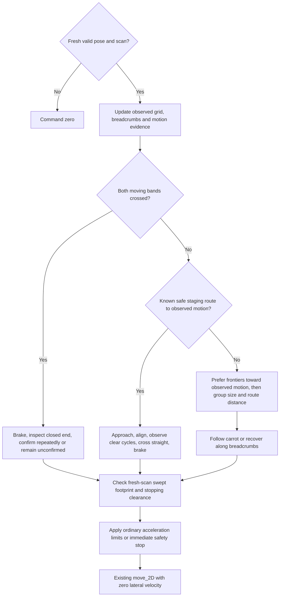

# RB2301 Final Project - Obstacle Course

The robot has to get through three sections of a "real-world" obstacle course: a zig-zag corridor with static obstacles, a small door, and dynamic swinging obstacles. You get the robot's pose and LiDAR scan. There is no occupancy grid, and the walls are rectilinear. Any approach is allowed.

Navigation is self-contained in the following file. Helpers are called from `ObstacleCourseNode.timer_callback()` after calibration:

```
src/rb2301_fp/rb2301_fp/obstacle_course.py
```

What you have: `self.pose` (`[x, y, heading]`, metres and degrees, from Gazebo odometry or Optitrack), `self.last_scan` (LiDAR ranges, set once the first scan arrives), `self.move_2D(x, y, turn)` to drive, and `self.is_simulation`, which is set automatically from the LiDAR scan size.

## Set up (simulation)

Requirements: Ubuntu with ROS 2 Jazzy and Gazebo Harmonic, `ros-jazzy-ros-gz`, numpy, and your existing RB2301 workspace (the folder containing `src/`, e.g. `~/Documents/rb2301`).

1. Get this repo: `git clone https://github.com/rudra-8000/rb2301_final_project.git` (or Code > Download ZIP).
2. Copy `fp.sh` and `gz_fp.sh` into the workspace folder, next to `src/`.
3. Copy `src/rb2301_fp` and `src/rb2301_gz` into your workspace's `src/`. The new `rb2301_gz` replaces your old one and has the worlds and launch files for CA1, CA2 and the final project.
4. Build:

```bash
cd ~/Documents/rb2301
chmod +x fp.sh gz_fp.sh
source /opt/ros/jazzy/setup.bash
colcon build --symlink-install
```

`--symlink-install` means edits to `obstacle_course.py` take effect without rebuilding.

## Run

Two terminals, both in the workspace folder:

```bash
./gz_fp.sh     # terminal 1: Gazebo. Wait until the course and robot appear
./fp.sh        # terminal 2: your node
```

The goal is to get past the moving obstacles. To start the robot somewhere else (for example past the gate), change `x:=` and `y:=` in `gz_fp.sh`; a commented example is in the file. Stop with `Ctrl+C`.

The current staged implementation starts **stopped**. It checks sensors, builds an observation grid, and displays a frontier plan. Simulation motion requires an explicit test selection:

```bash
# Motion primitives: run one at a time, with Gazebo running.
RB2301_STAGE=2 RB2301_TEST_PRIMITIVE=forward ./fp.sh
RB2301_STAGE=2 RB2301_TEST_PRIMITIVE=backward ./fp.sh
# Simulation-only crossing acceleration check (up to crossing_speed).
RB2301_STAGE=2 RB2301_TEST_PRIMITIVE=crossing_forward ./fp.sh
RB2301_STAGE=2 RB2301_TEST_PRIMITIVE=turn_left ./fp.sh
RB2301_STAGE=2 RB2301_TEST_PRIMITIVE=turn_right ./fp.sh

# Stopped mapping and planning checks.
RB2301_STAGE=3 ./fp.sh
RB2301_STAGE=4 ./fp.sh

# Stage 5: explore with the route follower.
RB2301_STAGE=5 RB2301_TEST_PRIMITIVE=navigate ./fp.sh

# Stage 6: recovery and observed moving-obstacle crossing (under validation).
RB2301_STAGE=6 RB2301_TEST_PRIMITIVE=navigate ./fp.sh

# Stage 7: the complete course, including conservative final recognition.
RB2301_STAGE=7 RB2301_TEST_PRIMITIVE=navigate ./fp.sh
```

Run only one controller at a time. Ctrl+C sends zero velocity before shutdown. Stage 6 recovery and observed moving-obstacle crossing are under test. Stage 7 completion is implemented and under simulation validation. Stage 5 can stop at `NO_PROGRESS` or `NO_REACHABLE_FRONTIER` without claiming success. Hardware motion is deliberately disabled in this checkpoint, including when these environment variables are set.

## Optional RViz view

The current session configuration is `log/fp_layouts/fp_debug.rviz`. Launch it with isolated display transforms:

```bash
rviz2 -d log/fp_layouts/fp_debug.rviz --ros-args \
  -r /tf:=/fp_debug/tf -r /tf_static:=/fp_debug/tf_static
```

If that temporary configuration no longer exists, set Fixed Frame to `fp_world`, add a MarkerArray display for `/fp_debug/markers`, a LaserScan display for `/fp_debug/scan` using Best Effort reliability, and a Map display for `/fp_debug/map`. Use a top-down camera and zoom out to see the corridor. Grid cells are observed free/occupied space; unmapped cells remain unknown. Cyan/orange points show LiDAR returns, green outlines show the body, purple points show frontiers, yellow lines show the route, red spheres show goals, orange spheres show the carrot, and pink lines show breadcrumbs. The orange goal outline shows the ordinary frontier turning allowance. A cyan arrow shows the preference toward observed motion; orange bands show observed moving regions and turn green after a full-body crossing.

The display scan is a copy with dedicated frame names and display timestamps. Navigation always uses the original sensor timestamps. No navigation helper reads RViz messages or the display transform stream.

Set `RB2301_DEBUG_VISUALS=0` before `./fp.sh` to disable all display publishing. To remove the RViz support later, remove `show_diagnostics()` and its call from `motion_stage()`, then remove the unused debug settings/state. Retain the navigation TF listener: it supplies the actual LiDAR mounting transform.

## Tuning parameters — current simulation candidates

Settings currently live in `nav_settings` inside `init_navigation()` in `obstacle_course.py`. They are Python settings, **not ROS 2 parameters yet**. Restart the controller after changing them. Change one related group at a time and repeat the same test layout before randomizing again.

These are simulation starting values. The footprint comes from the simulation collision meshes; acceleration, braking, margins and controller gains remain unvalidated on physical hardware. The existing hardware translation cap of 0.3 m/s is preserved independently.

### Body, sensing and stopping

| Setting | Current value / units | Tuning effect and symptoms |
| --- | --- | --- |
| `footprint_front` | 0.182 m | Pose-origin to front edge. Increase to include protrusions; too small permits front contact, too large rejects passages. |
| `footprint_rear` | 0.034 m | Positive distance behind the pose origin. Measure separately from the front. |
| `footprint_half_width` | 0.096 m | Half the full body width, including wheels. Affects both route clearance and the swept body. |
| `scan_timeout` | 0.5 s | Increase only for measured scan delays; decreasing detects dropouts earlier but may cause nuisance stops. |
| `pose_timeout` | 0.5 s | Same tradeoff for localization. Repeated source timestamps do not refresh freshness. |
| `pose_scan_tolerance` | 0.2 s | Maximum pose/scan timestamp mismatch. Larger values can smear walls during turns; fix clock alignment before increasing it. |
| `linear_speed` | 0.10 m/s | Higher speeds need more braking space and can worsen corner tracking. Start lower on hardware. |
| `angular_speed` | 0.30 rad/s | Maximum commanded turn rate. Higher values turn faster but need more swept clearance. |
| `minimum_turn_speed` | 0.14 rad/s | Command used outside the heading deadband. Increase only if turns stall; too high causes oscillation. The simulation stalled around 0.094 rad/s. |
| `linear_acceleration` | 0.20 m/s² | Higher values accelerate faster; lower values soften starts. |
| `linear_braking` | 0.40 m/s² | Used in stopping prediction and ordinary deceleration. A larger value assumes a shorter stop: never exceed measured physical braking capability. |
| `angular_acceleration` | 0.60 rad/s² | Limits normal turn-command changes. Reduce for abrupt turns. |
| `angular_braking` | 0.80 rad/s² | Angular stopping assumption. Overstating it underestimates the swept area. |
| `reaction_delay` | 0.20 s | Sensing/control delay included before braking. Increase for measured latency; reducing it can brake too late. |
| `clearance_margin` | 0.06 m | Required gap from the body. Increase for uncertainty; too large can make a narrow door unreachable. |
| `turn_drift_margin` | 0.04 m | Extra room at local goals for base movement during turns. Increase if turning from a reached goal causes a safety stop; measure drift on hardware. It does not change the physical footprint or the braking margin. |
| `resume_margin` | 0.02 m | Extra clearance above the stop margin before resuming. Increase to reduce chatter; too large can prevent restart in tight spaces. |
| `resume_scans` | 4 fresh scans | More scans require longer sustained clearance. Duplicate scans do not count. |

Safety stops bypass ordinary command smoothing. A smaller acceleration limit must not delay an urgent stop. The stopping sweep includes both translation and rotation; this is not a validated guarantee against swinging objects striking a stationary robot.

### Map, frontier selection and route following

| Setting | Current value / units | Tuning effect and symptoms |
| --- | --- | --- |
| `map_resolution` | 0.05 m/cell | Smaller cells preserve openings but increase memory, processing and ray gaps. Rebuild memory by restarting after changing it. |
| `mapping_range` | 2.5 m | Greater range observes farther but spreads rays apart and increases processing. This does not encode course dimensions. |
| `breadcrumb_spacing` | 0.15 m | Smaller spacing records more detail. Smaller values give a more detailed trail to retrace during recovery. |
| `frontier_standoff` | 0.25 m | Minimum distance from a frontier to its approach candidates. Larger values stay farther inside observed space but can reveal less around corners. |
| `approach_search_distance` | 0.75 m | Maximum inward search for a reachable approach with turning room. Increase when occluders leave no nearby safe approach; excessive distances can make observation goals less useful. |
| `minimum_frontier_size` | 5 cells | Ignore small groups after joining corner-touching frontier cells. Four-connected grouping previously split useful diagonal boundaries into two-cell fragments. |
| `minimum_goal_distance` | 0.40 m of grid route | Larger values avoid tiny local moves but can reject useful nearby approaches. |
| `frontier_revisit_distance` | 0.20 m | Stage 6+ excludes observation goals this close to travelled breadcrumbs. Larger values reduce repeated visits but can reject useful nearby viewpoints. Transit routes and explicit safety retreats can still use those cells. |
| `prefer_motion_frontiers` | true | Stage 6+ first prefers reachable groups toward observed motion, then group size and route length. Disable to compare with largest-group exploration. |
| `preferred_clearance` | 0.30 m | A* prefers more clearance up to this distance. Increase if routes hug obstacles; it does not change the largest-frontier selection rule. |
| `planning_interval` | 2.0 s | Retry interval while stopped without a goal. Shorter values search more frequently. |
| `look_ahead_distance` | 0.18 m | Larger carrots smooth tracking but cut corners more aggressively. Smaller values can produce slow, twitchy tracking. The A* route uses obstacle padding and carrot sightlines require observed free space; actual commands receive the full footprint braking check. |
| `goal_tolerance` | 0.08 m | Distance within which a local approach can finish, provided the actual stopping position also has turning clearance and the drift allowance. Smaller values demand more precise stopping. |
| `heading_gain` | 2.0 s⁻¹ | Increase for stronger heading correction; too high produces overshoot. Heading error is in radians. |
| `heading_derivative_gain` | 0.05 | Damps changing heading error. Higher values can amplify localization noise; reduce if commands jerk. |
| `distance_gain` | 1.0 s⁻¹ | Converts carrot distance into forward speed, up to the speed cap. Reduce for gentler approaches. |
| `turn_in_place_angle` | 8° | Above this error, translation stops while aligning. Lower values produce more stop/turn behavior; higher values produce wider moving turns. The narrow doorway needs much closer alignment than an open corridor. |
| `heading_tolerance` | 2° | Heading deadband and turn-test completion tolerance. Too small can cause chatter or deadband stalls. |
| `progress_distance` | 0.04 m | Route progress needed to refresh the stall timer. Larger values may falsely flag slow movement. |
| `progress_timeout` | 25.0 s | Longer values tolerate slower progress but detect stalls later. Safety waits pause this check; turning alone does not reset travelled progress. Set the timeout long enough for measured legitimate turns. Stage 6 replans and retraces breadcrumbs after a persistent blockage. |

Stages 4–5 select the largest reachable frontier group; ties use shortest grid distance. Stages 6–7 can first prefer groups toward sensor-observed motion and suppress repeated observation goals near the travelled trail. Within the preferred set, each group uses its nearest reachable approach with room for a full turn and the drift allowance. Approaches must have a known-free sightline to their frontier. A* routes use known free cells and obstacle clearance; route following independently checks fresh LiDAR. Routes may pass through a doorway too narrow for a full turn; local goals require turning room.

Carrot progress considers the current segment and its immediate successor. This lets a rounded corner advance without requiring the robot to touch the corner waypoint, while preventing a nearby later branch from taking over the path.

## Logic and mathematics

The timer uses ordinary priority checks. `begin_route()` resets follower state in one place; `heading_command()` supplies the common P/PD math; `route_stalled()` checks travelled progress. There is one observed grid, one A* planner and one carrot follower. Safety keeps its own history when goals change.



The controller has one loop: **sense → remember → choose/keep a goal → follow the route → check safety → publish**. RViz runs after the decision and does not supply navigation data. Distances are in metres, speeds in m/s, and control angles in radians; the supplied pose heading is converted from degrees.

### 1. Place each LiDAR return in the world

For ray index `i`, use the message metadata:

```text
a_i = angle_min + i * angle_increment
point_in_base = lidar_translation + range_i * [cos(a_i + lidar_yaw), sin(a_i + lidar_yaw)]
point_in_world = robot_position + R(robot_yaw) * point_in_base

R(theta) = [[cos(theta), -sin(theta)],
            [sin(theta),  cos(theta)]]
```

The mounting translation and yaw come from TF. A timestamped pose is matched to the scan. NaNs and below-minimum ranges are invalid. Maximum-range/no-return rays clear observed space but do not create an obstacle endpoint.

### 2. Remember observed cells

With resolution `h`, a world position belongs to cell `(floor(x/h), floor(y/h))`. Its centre is `((cell_x + 0.5)*h, (cell_y + 0.5)*h)`. Ray-traversed cells are free and finite obstacle endpoints are occupied; absent cells are unknown.

An occupied hit stores two evidence votes. Each different fresh scan that sees the cell free removes one vote. This prevents one grazing ray from immediately deleting an obstacle and allows an old swinging-obstacle trace to clear. The same scan never votes twice. Breadcrumbs record actual travelled positions, spaced by `breadcrumb_spacing`.

### 3. Choose useful unknown space

A frontier is a free cell with an unknown neighbour across one of its four edges. Frontier cells touching at an edge **or corner** belong to the same group. This distinction matters: a diagonal boundary should be one group, not many isolated dots. A* movement still uses four edge neighbours.

```text
information proxy = number of cells in the frontier group
motion direction d = observed_motion_target - robot_position
forward group = dot(group_centre - robot_position, d) > 0
selection priority = forward reachable group first, then largest group, then shorter route
```

The forward preference is enabled only when scan evidence supplies a motion direction; otherwise selection uses group size and distance. Groups behind remain a fallback. Unconfirmed range changes can supply a direction hint, but only repeatedly confirmed bands that were actually crossed can support completion. If the moving section is already mapped, the controller uses a known staging route without requiring another frontier.

The approach must lie in known free space, have a free sightline to its frontier, and provide turning room. The body can rotate into a circle of radius:

```text
r_turn = sqrt(max(front, rear)^2 + half_width^2)
```

Approach clearance adds the physical margin, measured turn-drift allowance, and half a grid-cell diagonal (`h/sqrt(2)`). This turning-room rule applies to local goals; it does not inflate the entire doorway route by that radius. Fresh scans also check candidates. A small correction within the original goal tolerance can retain the same observation goal; otherwise new obstacle evidence invalidates it.

### 4. Plan and follow a route

A* uses `f = g + heuristic`, with Manhattan distance as the four-neighbour heuristic. Its edge cost is:

```text
step_cost = 1 + max(0, preferred_clearance - obstacle_clearance) / h
```

This makes a route with room beside obstacles preferable to a wall-hugging route. It does not add weights to the frontier information score. Simplification removes collinear points and preserves corners.

For a route segment from `A` to `B`, project robot position `P` onto it:

```text
t = clip(dot(P-A, B-A) / dot(B-A, B-A), 0, 1)
s = segment_start_distance + t * segment_length
progress = max(previous_progress, s)
carrot_distance_along_route = min(progress + lookahead, route_length)
```

Progress can advance to the next adjacent segment when that segment is closer after rounding a corner. It cannot jump to a later branch. A carrot sightline must stay in observed free grid cells; the follower shortens lookahead or stops if that fails. The full rectangular footprint is checked along the actual commanded turning/braking arc on every tick. The follower does not require a hypothetical turn-in-place followed by a straight trip to the entire carrot to be feasible.

### 5. Convert carrot error to movement

```text
e_distance = norm(carrot - robot_position)
e_heading = wrap(atan2(carrot_y - robot_y, carrot_x - robot_x) - robot_yaw)

v = min(speed_limit, distance_gain * e_distance, distance_to_goal)
v = v * max(0, cos(e_heading))
w = clip(heading_gain * e_heading + derivative_gain * change_in_heading_error/dt,
         -turn_limit, turn_limit)
```

If heading error exceeds `turn_in_place_angle`, set `v = 0` until aligned. The heading deadband prevents tiny corrections; the minimum turn command overcomes the simulation's observed yaw deadband. Lateral velocity is zero.

For a doorway, the body's lateral extent at heading error `alpha` is approximately `front*abs(sin(alpha)) + half_width*abs(cos(alpha))`. It must fit within half the opening after clearance and tracking error are allowed. With the simulation dimensions, that extent is about 16.2 cm at 24° and 12.0 cm at 8°. This explains why early alignment matters.

### 6. Safety has final priority

Obstacle distance is measured from the full rectangular body. The body is swept through the proposed motion, reaction delay, and braking to a stop. A stationary-obstacle baseline is:

```text
trigger_distance_from_body = v * reaction_delay + v^2 / (2 * braking_deceleration) + margin
```

For `v = 0.10`, delay `0.20`, braking `0.40`, and margin `0.06`, this is approximately **0.0925 m**. These braking assumptions require physical measurement before hardware use. Decreasing scan clearance adds an earlier stop allowance.

Ordinary command changes are limited by `abs(delta_v) <= acceleration*dt` and the corresponding angular limit. Safety can command zero immediately. Resume requires a larger clearance and several different fresh scans. Stale or missing inputs also command zero. This is a tested control strategy, not a guarantee against a moving obstacle striking a stopped robot.

## Fixed-layout testing

Layout 001 is saved in `log/fp_layouts/layout_001.sdf`, with its checksum in `layout_001.sha256`. These are ignored test artifacts, independent of the controller. Replay it through the unchanged script:

```bash
env BASH_ENV="$PWD/log/fp_layouts/replay_env.sh" ./gz_fp.sh
```

The test wrapper disables the randomizer in that launch process and passes the saved world to Gazebo. It prints `FIXED LAYOUT 001` and verifies the checksum. Swinging actors still move, but their trajectories and all obstacle/wall positions remain fixed. Do not generate the next layout until the current one has been cleared reliably. Task-run terminals clear and exit after their commands finish; logs retain the evidence.

### Display and primitive-test settings

| Setting | Current value | Effect |
| --- | --- | --- |
| `debug_visuals` | true | Optional publishers only; disable with `RB2301_DEBUG_VISUALS=0`. |
| `debug_interval` | 0.2 s | Longer intervals reduce display load. Does not change the control timer. |
| `status_interval` | 1.0 s | Terminal print frequency, independent of the 20 Hz control timer. |
| `forward_test_distance` | 0.45 m | Distance for the simulation forward primitive. |
| `turn_test_angle` | 45° | Relative angle for left/right primitive tests. |
| `position_tolerance` | 0.015 m | Completion tolerance for the forward primitive. |

### Recovery and moving obstacles

These values are current simulation candidates. Crossing is still being validated; they are **not final accepted settings**.

| Setting | Current value / units | Tuning effect and symptoms |
| --- | --- | --- |
| `obstacle_wait_timeout` | 15 s | Longer waits tolerate a temporarily blocked path or a goal affected by confirmed motion longer. Short waits can cause needless backtracking. |
| `goal_cooldown` | 30 s | Time to avoid selecting a failed approach again. Longer values reduce repeated failures but delay revisiting newly useful space. Transit cells remain available. |
| `backtrack_distance` | 0.45 m of recorded trail | Increase to retreat farther before replanning; excessive retreat wastes time. Fresh LiDAR checks every retraced segment. |
| `motion_observation_interval` | 0.5 s | Interval between comparisons from settled viewpoints. Short intervals may show too little movement; long intervals take longer to confirm motion. |
| `motion_range_change` | 0.12 m | Reject smaller range changes as noise. Too small can mistake jitter for movement; too large misses slower motion. Tune with observation interval and actual noise. |
| `motion_confirmation_samples` | 3 observations/cell | Require repeated evidence before declaring a moving band. Larger counts take longer but reject isolated changes. |
| `motion_confirmation_wait` | 24.0 s | Maximum observation pause after a local goal when motion evidence exists, and recency window for unconfirmed hints. Increase for slower swings; too large delays exploring another area. A confirmed reachable staging route takes priority immediately. |
| `motion_minimum_span` | 0.30 m | Minimum extent of a repeatedly changing band. Increase to reject small artifacts; decrease only if measured moving objects have smaller sweeps. |
| `crossing_speed` | 0.30 m/s | Used only during an aligned simulation crossing. Higher values reduce crossing time but need more braking space. Hardware remains stopped; its existing 0.30 m/s cap is preserved. |
| `crossing_acceleration` | 0.80 m/s² | Crossing command ramp and time estimate. Increasing shortens the predicted crossing; physical acceleration must support that assumption. Other movement keeps `linear_acceleration`. |
| `crossing_padding` | 0.05 m | Allowance for unseen thickness and uncertainty beyond observed moving returns. Increase for larger/thicker obstacles and sensing uncertainty. |
| `crossing_time_margin` | 0.25 s | Extra time beyond the acceleration and reaction estimate. Increase for timing variation. If no observed interval is long enough, remain stopped. |
| `crossing_observed_windows` | 2 complete intervals | Number of previously measured intervals required. More observations increase waiting and help reveal variable periods. |
| `crossing_observation_timeout` | 35 s | Maximum time learning clear intervals at an aligned staging line. Smaller values recover sooner but can interrupt slow cycles; larger values tolerate more observation. Repeated intervals that are all too short trigger recovery sooner. |
| `crossing_maximum_approaches` | 2 approaches | Maximum distinct failed crossing lines. More attempts explore additional staging positions; exhausting the limit reports `NO_PROGRESS` with completion unconfirmed. |

A new static observation that invalidates an observation goal causes replanning from the current pose, with a cooldown on that goal region. It does not itself require reversing. A goal affected by a confirmed moving band remains stable during a temporary wait. A persistently blocked path or a genuine progress stall can trigger breadcrumb recovery. The direction of travel is chosen to avoid an unnecessary half-turn: it can follow the recorded trail forwards or backwards. Reverse travel uses the actual rear footprint and signed velocity.

Moving bands are confirmed using range changes from nearly identical, settled viewpoints. For each changed ray, the nearer of the old and new returns represents the moving occluder rather than the wall behind it. Repeated changed cells are grouped; their principal direction describes the observed sweep. This uses scans and pose, not Gazebo obstacle coordinates.

The robot approaches a stable staging point outside the observed sweep, aligns perpendicular to it, and measures clear/blocked transitions at its **actual** lateral position after turning. An occluded band is unknown. A single clear scan is insufficient. Repeated insufficient windows or the observation timeout trigger breadcrumb retreat and another staging line; the previous lateral line is excluded. Exhausted attempts stop with an explicit failure instead of waiting indefinitely. If the remaining travel until the whole rear clears the band is `L`, the conservative timing check is:

```text
required_time = L / crossing_speed
              + crossing_speed / (2 * crossing_acceleration)
              + reaction_delay + crossing_time_margin
available_time = shortest_recent_complete_clear_interval - elapsed_current_clear_time
cross only if available_time >= required_time
```

The acceleration term accounts for starting from rest. Braking is checked separately on every timer tick, including residual measured motion. The robot stops after its full rear clears the observed band plus margin and thickness allowance. This assumes the observed motion remains sufficiently repetitive. It is not a hardware guarantee or a prediction of arbitrary human motion.

### Completion recognition

| Setting | Current value / units | Tuning effect and symptoms |
| --- | --- | --- |
| `completion_required_bands` | 2 distinct observed bands | Course-specific evidence requirement. Counting frontiers or early dead ends cannot replace actually crossing these bands. |
| `completion_wall_distance` | 0.65 m from pose origin | Maximum distance at which to inspect a terminal front wall. Increasing can inspect earlier but creates larger gaps between LiDAR hits. |
| `completion_minimum_wall_span` | 0.20 m | Required observed length of each side wall along the travel direction. Larger values need more visible wall; too small can accept short fragments. |
| `completion_hold_time` | 6.0 s | Minimum continuous time with stable wall evidence while stopped. Increase for noisier sensing; a shorter value weakens repeated confirmation. |
| `completion_observations` | 30 different scans | Minimum sample count in addition to the hold time. Duplicate timestamps do not count. Tune with actual scan rate. |
| `completion_gap_factor` | 1.5, dimensionless | Allowance over expected angular spacing between wall returns. Too small rejects grazing-angle walls; too large can bridge missing evidence. A potentially traversable gap is still rejected. |

Completion requires actually passing the moving bands, then seeing a stable front wall joined to both side walls. The same wall positions must persist while commands and measured motion are stopped. Missing sides, openings, inconsistent motion directions, stale inputs and insufficient observations leave completion unconfirmed.

For a wall at perpendicular distance `d` from the LiDAR, its lateral intersection is `y = d*tan(theta)`. Thus adjacent angular samples have approximate spacing:

```text
wall_hit_spacing = (d*d + y*y) / d * abs(scan_angle_increment)
```

This explains why a continuous far corner can have widely separated hits. The coverage check accounts for this geometry and the actual LiDAR mount, and caps the allowed gap below the robot's required passage width. It does not fill unknown space or read the simulation walls.

### Physical measurements and tuning order

1. Measure front, rear and wheel/body width relative to the localization pose origin. Verify the pose origin corresponds to `base_footprint`; an Optitrack rigid-body offset needs accounting for before hardware motion is enabled.
2. Verify LiDAR translation and yaw in the robot's TF tree against the physical mounting. The helper looks up `base_footprint` to the scan frame; do not infer mounting yaw from scan indices.
3. With motion disabled, check frame alignment, straight walls, timestamps, invalid scans and stale-data stops. Measure scan/localization delays before selecting timeouts and `reaction_delay`.
4. Measure low-speed straight and angular stopping behavior, including command delay, on the actual surface. Choose conservative braking values and validate them at each intended speed.
5. Tune the minimum turn command, heading gains and acceleration at low speed. Then tune the carrot distance and turning threshold on a short path with a corner.
6. Check the complete body through the doorway. Correct dimensions, localization and tracking before reducing clearance to force passage.
7. Revalidate dynamic-obstacle waits and clear intervals separately. Simulation acceptance and separate physical trials remain necessary before claiming hardware performance.

### Verification status — 28 October 2026

**Resumed on frozen Layout 002.** The previous run oscillated near `(2.19, -0.40)` and reported `ROUTE_BLOCKED`. Rechecking all URDF collision meshes measured a body of 0.21479 m × 0.19145 m; the configured 0.216 m × 0.192 m footprint remains unchanged. Recorded scans permit a straight passage with 0.096 m minimum clearance. The A* route stays obstacle-padded. Carrot sightlines must be observed free; the full-body turning/braking check runs in `safe_motion()` on every command. Applying the route padding to the carrot’s hypothetical straight chord also caused unnecessary stops, so that duplicate constraint was removed. This removes a conflicting full-straight-chord test; the recorded next braking arc had 0.115 m clearance. The live regression is in progress. Acceptance remains **0/5**.

- Stage 1: projection/metadata, stopped commands, and live sensor interruption/recovery passed.
- Stage 2: forward, backward, left/right turns and a controlled barrier wait/resume passed. The reverse trial travelled 0.435 m with a minimum scan clearance of 0.125 m.
- Stage 3: five temporary occupied cells were added and all five cleared after removal and fresh scans.
- Stage 4: stopped goal/route displays and unreachable-frontier rejection passed. Diagonal frontier grouping and positive A* costs have regression checks.
- Stage 5: the recorded rounded-corner stall was fixed by advancing to the adjacent segment when that segment becomes closer. Layout 001 doorway replay travelled 5.87 m; independent checks measured 0.0719 m minimum scan clearance and 0.0709 m minimum body-to-door margin. All lateral commands were zero and shutdown was clean. This verifies that doorway trial, not complete-course acceptance.
- Stage 6: breadcrumb retracing, persistent-blockage recovery, observed motion bands and timed crossings have passed live checks on Layout 001. An earlier trial failed at 0.033 m clearance while waiting too close; that failure motivated staging outside the observed sweep. A later crossing run measured 0.0780 m minimum clearance.
- Stage 7: the motion-directed Layout 001 run completed in 253.86 s, measured 0.07299 m minimum scan clearance and 0.07234 m doorway margin, crossed both observed bands, and remained stopped for five seconds after completion. All independent audit checks passed. The shared route/heading cleanup also passed with diagnostics disabled in 253.90 s. Layout 002 then exposed unnecessary retreats after invalid static goals; its correction is being checked on that same frozen layout.
- The five consecutive complete randomized acceptance runs remain pending. Accepted randomized sequence: **0/5**. The successful Layout 001 development run does not establish this acceptance sequence.
- No hardware navigation or physical braking validation has been performed.

The initial Gazebo scan at simulation time 0.002 s reports -0.0592 m clearance before any nonzero command. Subsequent settled scans are positive. The earlier apparent observer/controller discrepancy compared this startup scan against a later controller measurement window. Reports retain startup readings separately; they are not evidence that the physical footprint or hardware sensing is validated.

Layout 001 remains available as a benchmark. Layout 002 is the current frozen layout; a failed attempt is retained in `log/fp_layouts/acceptance_attempt_01_failed.json`. Do not generate the next layout until the current one clears validation. A full-course success requires both scan-based clearance checks for the moving actors and conservative final-section recognition; a lack of reachable frontiers is never success.

### Future ROS 2 parameters and YAML

Keep these setting names and types when exposing them later. Declare parameters in the initialization helper, read their values into `nav_settings`, and provide a YAML file under the node name `obstaclecourse`. Launch with `./fp.sh --ros-args --params-file <file.yaml>`. Environment variables currently select staged simulation tests; they are not a YAML configuration system.

The later parameter implementation should validate positive dimensions/rates, integer scan counts, and relationships such as minimum turn speed not exceeding the turn cap. Geometry and map-resolution changes require stopping and resetting/replanning; do not silently apply them while moving. Runtime state such as maps, breadcrumbs and current goals must remain separate from configuration.

## The simulation map

- Each time you launch, the map is randomised from `obstacle_modifier.py`: gate position, zig-zag size, obstacle speed, and the position of the static obstacles. Switch each one on or off with the `randomise_...` variables at the top of that file.
- The untouched map is `obstacle_course_world_fp_original.sdf`. Do not edit it; the launched map is generated from it.
- The moving obstacles have no collision in the simulation.

## Problems

- `Permission denied` on a `.sh` file: `chmod +x fp.sh gz_fp.sh`.
- Gazebo hangs on "Requesting list of world names": an old Gazebo is still running. `pkill -9 ruby`, then run `./gz_fp.sh` again.
- Nothing happens when you run `./fp.sh`: Gazebo has to be fully loaded first (check terminal 1 is still running). The node waits for the LiDAR before it starts.
- `ros2: command not found`: `source /opt/ros/jazzy/setup.bash`. Run the scripts from the workspace folder (the one with `install/`).
- Gazebo window black, slow or crashing (virtual machine, no GPU): in `src/rb2301_gz/launch/fp_gazebo.launch.py` set `LIBGL_ALWAYS_SOFTWARE` to `"1"`.

## Real robot

Same flow as the slides. `NN` is your robot's number in two digits (robot 7 is `07`, address `192.168.1.207`), `<group>` is your group number. You edit on your laptop and copy the package to the robot.

**1. Make your workspace on the robot** (ssh in as usual):

```bash
ssh bingda@192.168.1.2NN
mkdir -p ~/Downloads/rb2301_fp_<group>/src
```

**2. Copy the package and the script** from your laptop's own terminal (not the ssh one). Repeat after every edit:

```bash
rsync -auvx --delete ~/Documents/rb2301/src/rb2301_fp bingda@192.168.1.2NN:~/Downloads/rb2301_fp_<group>/src
rsync -auvx --delete ~/Documents/rb2301/fp.sh bingda@192.168.1.2NN:~/Downloads/rb2301_fp_<group>
```

**3. Build on the robot** (ssh terminal):

```bash
cd ~/Downloads/rb2301_fp_<group>
colb                    # alias for colcon build --symlink-install
```

**4. Run each of these in its own ssh terminal** (or use `tmux` on the robot to split one ssh into several terminals):

```bash
basecontrol             # alias for ros2 launch base_control_ros2 base_control.launch.py
rplidar                 # alias for ros2 launch rplidar_ros rplidar.launch.py
vrpn                    # alias for ros2 launch vrpn_mocap client.launch.yaml server:=192.168.1.199 port:=3883
cd ~/Downloads/rb2301_fp_<group> && ./fp.sh
```

Add `--calibrate` to the last command (`./fp.sh --calibrate`) to only print your pose and never drive. Stay out of the Optitrack area while the robot runs.

What is different from the simulation:

- **Pose frame.** On the real robot `self.pose` is in the **CA2 maze frame**: metres from the corner of the CA2 maze, heading 0 along its +x axis and +90 along +y (counter-clockwise positive). The mapping from Optitrack to that frame is in `src/rb2301_fp/rb2301_fp/optitrack_variables.config`, already filled in. Don't edit it. If the calibration changes you will get a new file to drop in.
- **Course coordinates.** In the simulation the robot starts at `(0, 0)` facing +x. If you want the same numbers on the real robot, `self.to_course()` converts a pose from the CA2 maze frame to the course frame. It needs the position of the course start point in the maze frame (`[course]` in the config), which is not set yet, so for now it returns the pose unchanged.
- **Robot number.** The node reads the Optitrack topic of its own robot from `ROS_DOMAIN_ID` (already set on each robot) and prints it at start-up (`/vrpn_mocap/bingda_0NN/pose`).
- **Rigid bodies** are created in Motive with the robot facing +y of the CA2 maze. If you reset one, face the robot +y first.
- **Checking the pose.** Run the node with `--calibrate`, for example `./fp.sh --calibrate` on the robot. It prints the raw Optitrack pose and the maze-frame pose twice a second and never sends a drive command, so you can move the robot by hand and read off coordinates (for example the position of the gate). Start `rplidar` first, otherwise the node waits for the LiDAR.
